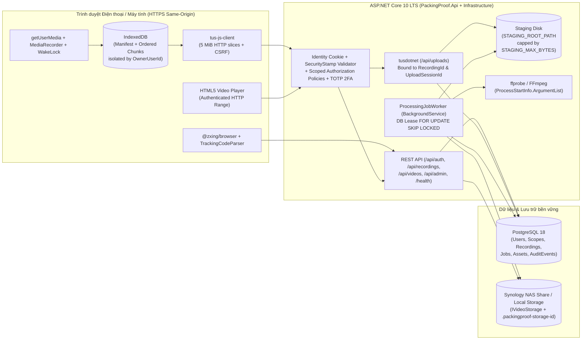
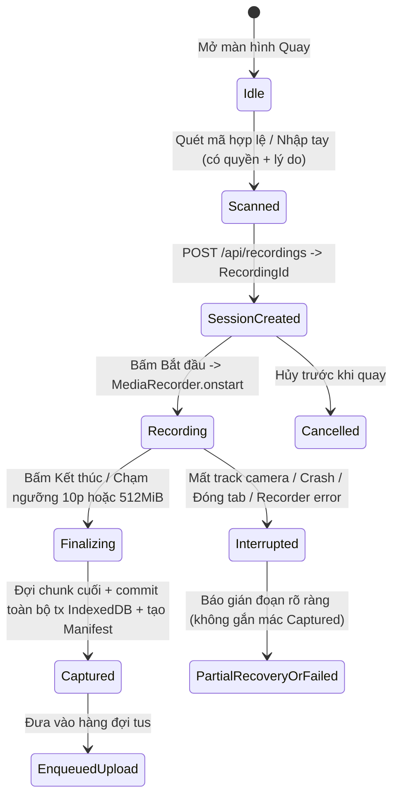
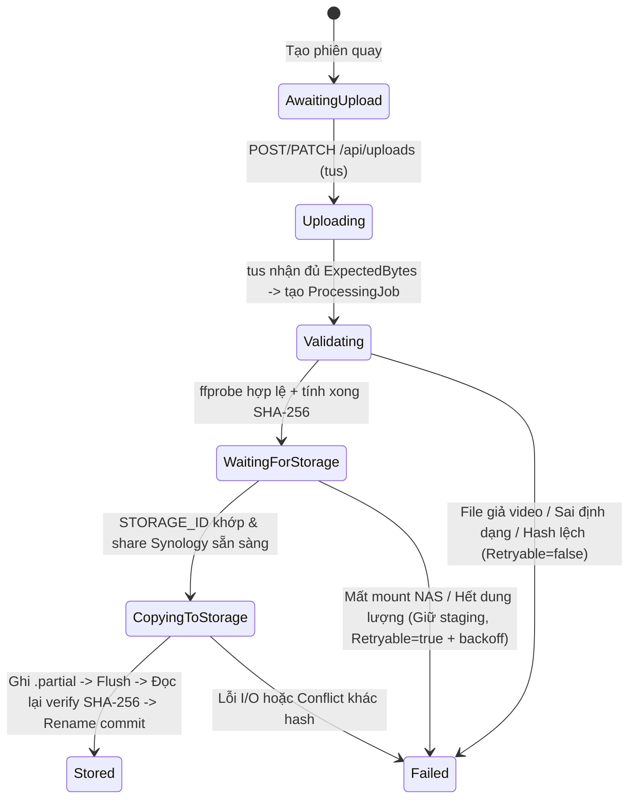

# Thiết kế kiến trúc hệ thống — PackingProof Web

## 1. Tổng quan & Mục tiêu kiến trúc

**PackingProof Web** là ứng dụng web ưu tiên thiết bị di động (mobile-first web + PWA app shell tùy chọn) cho phép nhân viên kho quét mã vận đơn trên tem đơn hàng TikTok, quay video quá trình đóng gói trực tiếp từ trình duyệt điện thoại, lưu tạm an toàn theo từng chunk vào IndexedDB, tải lên có thể tiếp tục (resumable upload qua giao thức `tus`) và lưu trữ có xác minh toàn vẹn (`SHA-256`) lên NAS Synology (hoặc thư mục cục bộ ở chế độ `LocalDevelopment`).

### Nguyên tắc thiết kế cốt lõi
1. **Không mất dữ liệu âm thầm**: Dữ liệu từ `MediaRecorder` được tuần tự hóa vào IndexedDB theo từng chunk trước khi báo hoàn tất; chỉ xóa dữ liệu tạm trên thiết bị sau khi backend xác nhận `StorageStatus = Stored`.
2. **Tách biệt rõ trạng thái**: Tách độc lập 3 nhóm trạng thái `CaptureStatus` (quay), `StorageStatus` (nhận & lưu NAS) và `PreviewStatus` (chuyển mã bản xem MP4). Hoàn tất `tus` chỉ mang ý nghĩa **Đã nhận trên máy chủ**, không đồng nghĩa **Đã lưu NAS**.
3. **An toàn lưu trữ NAS**: Kiểm tra file định danh `STORAGE_ID` trên share Synology trước khi đọc/ghi; ghi vào file tạm `.partial` ngay trên share đích, flush xuống đĩa, đọc lại kiểm tra kích thước + `SHA-256`, rồi mới commit bằng thao tác rename nguyên tử. Nếu mất mount, tuyệt đối không tự tạo thư mục local giả làm NAS.
4. **Phân quyền theo phạm vi tài nguyên (Permission + Resource Scope)**: Mọi thao tác API, `tus` (`POST/HEAD/PATCH/DELETE`), phát video `HTTP Range`, tải file gốc và quản trị đều kiểm tra quyền kèm phạm vi (`Own`, `Warehouse`, `Shop`, `All`) ở phía server. Thay đổi quyền hoặc thu hồi phiên có hiệu lực ngay ở request kế tiếp.
5. **Độc lập TikTok API ở bản đầu, sẵn sàng mở rộng DTD Commerce**: Vận hành độc lập dựa trên `TrackingNumber` (tách biệt với `TikTokOrderId` nullable), chừa sẵn interface `IOrderLinkResolver` để tích hợp DTD Commerce về sau.

---

## 2. Kiến trúc tổng thể (Modular Monolith)



### Cấu trúc thư mục dự án
- `backend/PackingProof.slnx`
  - `backend/src/PackingProof.Core/`: Entities, Enums, Permission constants, Value Objects, Interfaces (`IVideoStorage`, `ITrackingCodeParser`, `IMediaInspector`, `IPreviewTranscoder`, `IScopeAuthorizationService`, `IGrantCeilingValidator`, `IOrderLinkResolver`).
  - `backend/src/PackingProof.Infrastructure/`: `PackingProofDbContext` (EF Core + Npgsql), Migrations, Identity configuration, `TusDiskStoreAdapter`, `FileSystemVideoStorage` (`LocalDevelopment` & `SynologyMounted`), `FfprobeMediaInspector`, `FfmpegPreviewTranscoder`, `ProcessingJobWorker`, Seed/Bootstrap `SuperAdmin`.
  - `backend/src/PackingProof.Api/`: Controllers/Endpoints, Cookie + Antiforgery CSRF, `ImmediateSessionValidator`, Resource Authorization Handlers, OpenAPI, `/health/live` & `/health/ready`.
  - `backend/tests/PackingProof.UnitTests/`: Kiểm thử đơn vị logic nghiệp vụ cốt lõi.
  - `backend/tests/PackingProof.IntegrationTests/`: Kiểm thử tích hợp API, phân quyền, `tus`, `HTTP Range`, crash recovery với database và filesystem tách biệt.
- `frontend/`: React + TypeScript + Vite
  - `src/features/auth/`: Đăng nhập, đăng ký chờ duyệt, đặt lại mật khẩu, thiết lập & xác thực TOTP 2FA.
  - `src/features/dashboard/`: Thống kê vận hành thật từ PostgreSQL theo phạm vi quyền.
  - `src/features/recording/`: Kiểm tra môi trường (HTTPS, camera, codec, quota), quét mã `@zxing/browser`, parser mã vận đơn, quản lý camera đơn luồng, `MediaRecorder` state machine, `WakeLock`.
  - `src/features/upload-queue/`: IndexedDB lưu manifest + raw chunks theo `ownerUserId`, hàng đợi upload tuần tự (1 upload chính tại một thời điểm), khôi phục offset thực từ server qua `tus` `HEAD`.
  - `src/features/videos/`: Danh sách, bộ lọc theo phạm vi, trình phát `HTTP Range`, chi tiết bản ghi, ghi chú, `Hold`, tải file gốc, yêu cầu/duyệt xóa.
  - `src/features/admin/`: Quản trị người dùng/duyệt/khóa/scope/thu hồi phiên, ma trận vai trò & grant ceiling, cấu hình storage/kiểm tra kết nối/retention, nhật ký audit.
  - `tests/`: Vitest + `fake-indexeddb`.
- `e2e/`: Playwright với fake media stream kiểm chứng luồng trình duyệt đầu-cuối.
- `deploy/`: `docker-compose.yml`, `Caddyfile` (HTTPS same-origin), `nginx.conf.example`.
- `docs/`: Tài liệu thiết kế, kế hoạch, tiến độ, phân quyền, triển khai Synology/IIS, báo cáo test và checklist thiết bị thật.

---

## 3. Mô hình dữ liệu (PostgreSQL & EF Core)

Tất cả thời gian trong cơ sở dữ liệu lưu chuẩn **UTC** (`timestamptz`). Việc chia thư mục ngày lưu trữ và hiển thị giao diện quy đổi theo múi giờ **`Asia/Ho_Chi_Minh`** (`UTC+7`).

### Các bảng chính
1. **Identity & Phân quyền mở rộng**
   - `Users` (kế thừa `IdentityUser<Guid>`): `FullName`, `ApprovalStatus` (`PendingApproval`, `Active`, `Locked`), `DefaultShopId?`, `DefaultWarehouseId?`, `CreatedAtUtc`, `ApprovedAtUtc?`, `ApprovedByUserId?`, `ForcePasswordReset`. (Sử dụng `SecurityStamp` để thu hồi phiên tức thì).
   - `Roles` (kế thừa `IdentityRole<Guid>`): `Description`, `IsSystemRole`, `CreatedAtUtc`.
   - `Permissions`: `Code` (PK, vd: `recording.create`), `Group`, `Description`.
   - `RolePermissions`: `(RoleId, PermissionCode)` unique.
   - `UserScopeGrants`: `Id`, `UserId`, `RoleId`, `ScopeType` (`Own`, `Warehouse`, `Shop`, `All`), `ShopId?`, `WarehouseId?`, `GrantedByUserId`, `CreatedAtUtc`.
2. **Tổ chức kho vận**
   - `Shops`: `Id`, `Code`, `Slug` (unique, chỉ `[a-z0-9-]`), `Name`, `AllowedStorageSubdir`, `IsActive`.
   - `Warehouses`: `Id`, `ShopId`, `Code`, `Name`, `IsActive`.
   - `PackingStations` (tùy chọn): `Id`, `WarehouseId`, `Code`, `Name`, `IsActive`.
3. **Quay, Upload & Lưu trữ Video**
   - `Recordings`:
     - `Id` (`Guid` UUID v7/v4), `OwnerUserId`, `ShopId`, `WarehouseId`, `PackingStationId?`
     - `TrackingNumber` (`varchar(128)`, giữ nguyên chuỗi gốc gồm số `0` ở đầu và hoa/thường; **không** đặt unique toàn hệ thống)
     - `SafeTrackingSegment` (`varchar(128)`, backend chuẩn hóa an toàn cho đường dẫn)
     - `CarrierCode` (`varchar(32)?`), `TikTokOrderId` (`varchar(64)?` — điểm mở rộng cho DTD Commerce)
     - `Source` (`RecordedInBrowser`, `Imported`)
     - `ManualEntryReason` (`varchar(500)?`), `LinkedFromRecordingId` (`Guid?` — khi quay lại do sai mã)
     - `CaptureStatus` (`Created`, `Recording`, `Captured`, `Interrupted`, `Cancelled`)
     - `StorageStatus` (`AwaitingUpload`, `Uploading`, `Validating`, `WaitingForStorage`, `CopyingToStorage`, `Stored`, `Failed`)
     - `PreviewStatus` (`NotRequired`, `Pending`, `Processing`, `Ready`, `Failed`)
     - `ClientMimeType?`, `ActualMimeType?`, `ActualContainer?`, `VideoCodec?`, `AudioCodec?`
     - `DurationSeconds` (`double?`), `Width?`, `Height?`
     - `StartedAtUtc?`, `EndedAtUtc?`, `ServerReceivedAtUtc?`, `StoredAtUtc?`
     - `Hold` (`bool`, default `false`), `HoldReason?`, `HoldUpdatedByUserId?`, `HoldUpdatedAtUtc?`
     - `IsSoftDeleted` (`bool`, default `false`), `DeletedAtUtc?`, `PhysicalDeletedAtUtc?`
     - `LastErrorCode?`, `UserSafeErrorMessage?`, `IsRetryable` (`bool`, default `false`)
     - `CreatedAtUtc`, `UpdatedAtUtc`, `xmin` (PostgreSQL concurrency token).
   - `UploadSessions`:
     - `Id` (`Guid`), `RecordingId` (unique active primary upload hoặc unique constraint `(RecordingId)` cho phiên chính), `OwnerUserId`, `TusResourceId` (unique), `ExpectedBytes`, `ReceivedBytes`, `ClientSha256?`, `Status` (`Initiated`, `Receiving`, `Completed`, `Expired`, `Aborted`), `StagingFilePath`, `ExpiresAtUtc`, `CreatedAtUtc`, `CompletedAtUtc?`.
   - `VideoAssets`:
     - `Id` (`Guid`), `RecordingId`, `Kind` (`Original`, `Preview`) — **Unique index `(RecordingId, Kind)`** đảm bảo mỗi phiên chỉ commit đúng 1 asset gốc và tối đa 1 asset preview!
     - `StorageProfileId`, `RelativePath`, `MimeType`, `SizeBytes`, `Sha256`, `VerifiedAtUtc`, `CreatedAtUtc`.
   - `ProcessingJobs`:
     - `Id` (`Guid`), `RecordingId`, `JobType` (`ValidateAndStoreOriginal`, `GeneratePreview`, `DeletePhysicalAssets`), `Status` (`Queued`, `Running`, `Succeeded`, `Failed`, `DeadLetter`), `AttemptCount`, `MaxAttempts`, `NextAttemptAtUtc`, `LeaseOwner?`, `LeaseExpiresAtUtc?`, `LastErrorCode?`, `LastErrorDetail?`, `CreatedAtUtc`, `CompletedAtUtc?`.
     - Unique active job constraint theo `(RecordingId, JobType)` để chống callback lặp hoặc nhân đôi job.
   - `StorageProfiles`:
     - `Id`, `Name`, `Mode` (`LocalDevelopment`, `SynologyMounted`), `ExpectedStorageId`, `AllowedSubdirectoriesJson`, `MaxRecordingSeconds`, `MaxUploadBytes`, `MaxLocalPendingRecordings`, `RetentionEnabled` (default `false`), `RetentionDays`, `EnableAudioRecording` (default `false`), `UpdatedAtUtc`, `UpdatedByUserId?`.
   - `VideoNotes`: `Id`, `RecordingId`, `AuthorUserId`, `Content`, `CreatedAtUtc`.
   - `DeletionRequests`: `Id`, `RecordingId`, `RequestedByUserId`, `Reason`, `Status` (`Pending`, `Approved`, `Rejected`, `Cancelled`), `ReviewedByUserId?`, `ReviewNote?`, `CreatedAtUtc`, `ReviewedAtUtc?`.
   - `AuditEvents` (append-only): `Id` (`bigint`/`Guid`), `OccurredAtUtc`, `ActorUserId?`, `ActorEmail?`, `Action`, `EntityType`, `EntityId?`, `ShopId?`, `WarehouseId?`, `Outcome` (`Success`, `Denied`, `Failed`), `IpAddress?`, `UserAgent?`, `MetadataJson` (đã lọc bỏ hoàn toàn secret/token/cookie/raw nhạy cảm).

### Chỉ mục (Indexes) tối ưu tra cứu
- `IX_Recordings_ShopId_TrackingNumber` (`ShopId`, `TrackingNumber`)
- `IX_Recordings_TrackingNumber_Pattern` (`TrackingNumber` `varchar_pattern_ops` / trigram phục vụ tìm chính xác và một phần mã)
- `IX_Recordings_ShopId_WarehouseId_CreatedAtUtc`
- `IX_Recordings_OwnerUserId_CreatedAtUtc`
- `IX_Recordings_StorageStatus_CaptureStatus`
- `IX_ProcessingJobs_Status_NextAttemptAtUtc_LeaseExpiresAtUtc`
- `UX_VideoAssets_RecordingId_Kind` (`RecordingId`, `Kind` UNIQUE)
- `UX_UploadSessions_TusResourceId` (`TusResourceId` UNIQUE)

---

## 4. State Machine & Luồng xử lý

### 4.1. Luồng Quay & Lưu tạm trên trình duyệt (`CaptureStatus`)


- **Quản lý tài nguyên Camera đơn luồng**: Khi ở bước quét mã, `@zxing/browser` giữ video stream. Trước khi khởi tạo `MediaRecorder` (hoặc tái sử dụng cùng `MediaStream` đã khóa track), bộ giải mã ZXing bắt buộc gọi `scannerControls.stop()` để dừng vòng lặp decode frame, tránh tranh chấp CPU/camera trên điện thoại.
- **Tuần tự hóa IndexedDB**: Mỗi sự kiện `ondataavailable` đẩy `Blob` -> `ArrayBuffer` vào một hàng đợi Promise nối tiếp (`writeChain = writeChain.then(...)`), chỉ tăng `seq` và cập nhật byte count sau khi `IDBTransaction.oncomplete` kích hoạt.

### 4.2. Luồng Upload `tus` & Xử lý lưu Synology (`StorageStatus` & `PreviewStatus`)


### Quy tắc Idempotency & Phục hồi sau sự cố (Crash Recovery)
1. **Double-click / Callback lặp ở `tus`**: `OnFileCompleteAsync` sử dụng ràng buộc khóa/upsert theo `(RecordingId, JobType = ValidateAndStoreOriginal)` trong một transaction DB — gọi nhiều lần chỉ tạo đúng 1 `ProcessingJob`.
2. **Worker crash sau khi rename lên NAS nhưng trước khi lưu DB**: Khi job được lease lại sau thời gian `LeaseExpiresAtUtc`, `FileSystemVideoStorage.CommitFromStagingAsync` kiểm tra nếu file đích `MAVANDON_<RecordingId>.<ext>` đã tồn tại trên NAS:
   - Đọc lại file trên NAS và tính `SHA-256`.
   - Nếu trùng khớp `SHA-256` của bản staging: **reconcile thành công** (`Stored`), tạo/cập nhật `VideoAsset` mà không ghi đè hay báo lỗi giả.
   - Nếu khác `SHA-256`: đánh dấu lỗi `STORAGE_HASH_CONFLICT` (`Retryable = false`), giữ nguyên cả hai và ghi cảnh báo để admin kiểm tra, tuyệt đối không ghi đè.
3. **Dọn dẹp có điều kiện**:
   - Thiết bị (IndexedDB) chỉ xóa chunks cục bộ khi polling/fetch trạng thái phiên trả về `StorageStatus == Stored`.
   - Máy chủ chỉ xóa file trong `STAGING_ROOT_PATH` sau khi `Original` đã `Stored` (và job `GeneratePreview` đã hoàn tất hoặc `NotRequired`).

---

## 5. Bảo mật, Xác thực & Phân quyền (RBAC + Scope)

### 5.1. Xác thực, Cookie, CSRF & Thu hồi phiên tức thì
- **Frontend & API cùng origin** qua HTTPS (reverse proxy ở môi trường triển khai và Vite proxy ở môi trường dev).
- **Cookie Identity**: `HttpOnly = true`, `SecurePolicy = Always` (ở production/HTTPS), `SameSite = Lax`.
- **CSRF**: Cung cấp endpoint `GET /api/auth/csrf` phát hành antiforgery token; mọi request thay đổi dữ liệu dùng cookie (`POST`, `PUT`, `PATCH`, `DELETE`, bao gồm toàn bộ các request `tus` `POST`/`PATCH`/`DELETE`) bắt buộc gửi header `X-CSRF-Token`.
- **Thu hồi hiệu lực tức thì**: Trong `CookieAuthenticationEvents.OnValidatePrincipal`, hệ thống đối chiếu `SecurityStamp`, `ApprovalStatus == Active` và trạng thái khóa tài khoản từ DB ở **mọi request** (bao gồm `tus` chunk `PATCH` và `/api/videos/{id}/stream`). Khi Admin đổi quyền, thu hồi scope, khóa tài khoản hoặc bấm "Thu hồi phiên", `SecurityStamp` đổi ngay lập tức -> request kế tiếp bị chặn `401`/`403`.
- **TOTP 2FA**: Hỗ trợ thiết lập khóa TOTP chuẩn RFC 6238 (quét QR bằng Google/Microsoft Authenticator + mã khôi phục một lần) cho `SuperAdmin` và `Admin`.

### 5.2. Mô hình Kiểm tra Quyền + Phạm vi (Grant Ceiling & Resource Scope)
- Một người dùng có thể có một hoặc nhiều `UserScopeGrant(RoleId, ScopeType, ShopId?, WarehouseId?)`.
- Quyền hiệu lực trên tài nguyên `R(OwnerUserId, ShopId, WarehouseId)` thỏa mãn khi tồn tại ít nhất một grant mà:
  1. Role chứa `PermissionCode` yêu cầu; VÀ
  2. Scope khớp với `R`:
     - `All` (chỉ hợp lệ nếu Role là `SuperAdmin`)
     - `Shop` với `grant.ShopId == R.ShopId`
     - `Warehouse` với `grant.WarehouseId == R.WarehouseId`
     - `Own` với ` currentUserId == R.OwnerUserId`
- **Grant Ceiling**: Khi người dùng `A` cấp role/scope cho người dùng `B` hoặc tạo/sửa role tùy chỉnh:
  - Tập quyền của role được cấp phải là **tập con** của các quyền mà `A` đang sở hữu ở chính scope đó.
  - `A` không được cấp scope rộng hơn scope của mình (ví dụ Admin của `ShopA` không thể cấp quyền ở `ShopB` hoặc `All`, không thể gán `SuperAdmin`).
  - Không ai được tự nâng quyền của chính mình hoặc xóa/khóa/hạ quyền `SuperAdmin` hoạt động cuối cùng.

---

## 6. Kết nối Synology NAS & Giới hạn trình duyệt di động

### 6.1. Hai chế độ Storage
| Chế độ | Mục đích | Cơ chế kiểm tra an toàn | Hiển thị trên giao diện |
| --- | --- | --- | --- |
| `LocalDevelopment` | Phát triển & kiểm thử local | Ghi vào thư mục local được cấu hình | Badge nổi bật: **"Chế độ thử nghiệm — lưu local"**; trạng thái **"Đã lưu cục bộ (Local)"** |
| `SynologyMounted` | Vận hành thật với Synology NAS | Bắt buộc file `.packingproof-storage-id` tại `NAS_ROOT_PATH` khớp biến `STORAGE_ID` + test đọc/ghi | Trạng thái **"Đã lưu NAS"** chỉ sau khi commit & verify hash thành công |

### 6.2. Đường dẫn lưu trữ chuẩn hóa
```text
<NAS_ROOT_PATH>/
  ├── .packingproof-storage-id
  └── <ShopSlug>/
        └── <yyyy>/<MM>/<dd>/                  # Theo múi giờ Asia/Ho_Chi_Minh
              └── <SafeTrackingNumber>/
                    ├── <SafeTrackingNumber>_<RecordingId>.webm       # Bản gốc giữ nguyên container/codec
                    └── <SafeTrackingNumber>_<RecordingId>_preview.mp4 # Bản xem H.264 (chỉ tạo khi cần)
```

### 6.3. Giới hạn thực tế của trình duyệt điện thoại & PWA
- Camera (`getUserMedia`) trên điện thoại bắt buộc **HTTPS với chứng chỉ được thiết bị tin cậy** (trừ `localhost` ngay trên chính thiết bị đó; mở qua IP LAN `http://192.168.x.x` sẽ bị trình duyệt chặn camera).
- Service Worker của PWA **chỉ cache App Shell tĩnh** (`index.html`, JS/CSS bundle, icons); tuyệt đối không intercept hay cache `/api/*`, `/api/uploads/*` hoặc luồng video `/stream`.
- Trình duyệt di động (đặc biệt iOS Safari và Chrome Android khi tắt màn hình/chuyển app/có cuộc gọi) có thể thu hồi camera hoặc tạm dừng mạng bất cứ lúc nào: ứng dụng sử dụng `Screen Wake Lock API` (kèm theo dõi sự kiện `release`), bắt mọi sự kiện `visibilitychange`, `pagehide`, `track.ended`, `recorder.onerror` để chốt các chunk đã lưu hợp lệ, dừng bộ đếm ngay lập tức và đánh dấu rõ `Interrupted` thay vì giả vờ video hoàn chỉnh.

